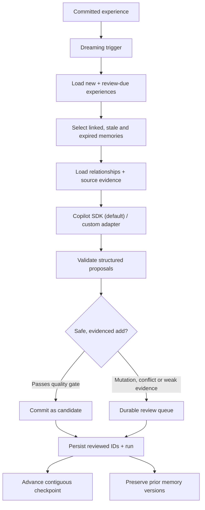

# Agent Memory Dreaming: design and integration

## Decision

`@saga/agent-dreaming` is the self-contained owner of the complete Agent Memory lifecycle. Experience, Evidence, Memory, Knowledge, retrieval, context assembly, feedback, scheduling, persistence and authorization primitives belong inside this package; no other internal package is required. The current release implements the core Dreaming / Memory lifecycle. Knowledge-page maintenance and the end-to-end Context Builder are accepted next-phase work and must also be implemented here. Copilot is the built-in optional model adapter; other model providers use the package-owned runtime contract.

The design follows [Anthropic's components of agent memory](https://www.anthropic.com/research/components-of-agent-memory): raw experiences remain inspectable, durable memory is derived from them, knowledge is maintained over time, and only a bounded, task-relevant context is injected into future tasks. See the package [Decision](../packages/agent-dreaming/DECISION.md) and [architecture analysis](../packages/agent-dreaming/ARCHITECTURE-ANALYSIS.md).

## Target internal responsibilities

All capabilities below are owned by internal modules of `@saga/agent-dreaming`, not separate package dependencies. Knowledge page maintenance and complete Context Assembly are target capabilities, not claims about the current release:

- Experience and Evidence: immutable source material, provenance, append-only history, evidence resolution and historical search.
- Memory: durable memory records, authority, lifecycle, relationships and version history.
- Knowledge: topic pages, knowledge relationships, maintenance proposals, indexes and version history.
- Retrieval: SQLite full-text search, optional semantic/vector search, ranking and bounded relationship expansion.
- Context: always-on Memory Manifest, task-aware selection, de-duplication, budget enforcement and prompt-ready rendering.
- Dreaming and Feedback: bounded replay, proposal validation, automatic consolidation and task-outcome feedback.
- Persistence and Operations: SQLite, migrations, transactions, scheduler, worker, leases, checkpoints and run ledger.
- Host application: authentication, trusted owner identity, authorization of source records and application-specific source adapters.

## Execution

A run is bounded by batch size, maximum batches, memory count, relationship count, evidence count and prompt characters. The built-in SQLite repository ranks memories using source-reference overlap, optional local vector similarity, expiry, staleness and importance. The engine persists the model-reported `reviewedMemoryIds` separately from experience review. Only a contiguous processed prefix advances the checkpoint. A per-scope lease prevents concurrent workers from applying the same work; the engine renews the lease during long model calls. Knowledge-page maintenance and Memory Manifest / task-aware Context rebuilding are the next implementation phase described in the package architecture analysis; they are not yet part of the current release.

## Runtime contract

`DreamingRuntime.generate()` is the single provider boundary. The built-in `CopilotDreamingRuntime` calls `@microsoft/copilot-sdk` directly, creates an isolated short-lived session, requests JSON Schema output and uses an empty tool surface by default. It does not reuse conversation history between batches.

Other model providers can implement the same interface. Provider-specific authentication, session lifecycle and model options stay in the adapter. The core engine has no dependency on another internal package.

## Persistence and recovery

`SqliteDreamingStore` currently persists experiences, memories, relationships, evidence, feedback, checkpoints, runs, proposals, applied-proposal idempotency keys, leases and prior memory snapshots. The planned Knowledge extension will add page / link / version / index tables; the planned Context extension will add a generated Memory Manifest and context-build records. Mutations run in transactions; the previous record is captured before update, merge, supersede or archive.

SQLite is suitable for local/single-host use. Multi-host deployments should replace it with a shared transactional repository and distributed lease. The process-local timer is only a trigger; guaranteed scheduling requires a durable worker or external scheduler.

## Trust boundary

The model only proposes changes. The engine validates scope, targets, evidence provenance and relationship endpoints before applying a valid proposal automatically. Invalid proposals are rejected. New or uncertain memories can remain `candidate`; candidate is not a human-approval queue. Explicit user memories are protected from model-derived updates.

Quality scores (confidence, durability, specificity and contradiction risk) are triage hints, not calibrated truth or permission to promote a memory. Expiry triggers re-review; it does not trigger deletion. The host authenticates the user, supplies the trusted scope and authorizes source records. The package enforces its own scope and mutation invariants.

The planned Context Builder will apply lifecycle / expiry / authority rules before injection, and will report selected and omitted records. It must not expose candidate or unclassified content by default.

## Long-term quality feedback

The host records immutable feedback against a memory ID: task usefulness after retrieval, later evidence support/contradiction, explicit user corrections, and (for legacy integrations) human review outcomes. A retrieval event is not automatically positive; useful/not-useful should be emitted only when the task outcome is known. The planned Context API will return memory / page IDs and versions so feedback can be tied to the exact content injected into a task.

`evaluateMemoryQuality()` computes separate recency-weighted usefulness and evidence-support rates over a 180-day window with a 90-day half-life. It reports sample size, effective sample size, corrections and human rejections. Review thresholds require repeated observations; a single negative retrieval is not enough. Human rejection is an explicit review signal.

Feedback never mutates memory state. An accepted human review (`confirmed` or `edited`) creates a comparison point. With at least three non-neutral retrieval outcomes before and three after that point, quality evaluation reports baseline and follow-up usefulness. The comparison is descriptive, not causal; insufficient samples remain inconclusive.

## Non-goals

No external graph database, multi-host scheduler, autonomous trust promotion, provider-specific tool execution or application identity provider is built into Dreaming. SQLite full-text search, optional local vector retrieval, bounded relationship traversal, durable local scheduling, context assembly and authorization policy primitives are package-owned capabilities. The host still authenticates users and supplies authorized source records. The optional Copilot adapter is the default model connection, not a permission to execute tools.
