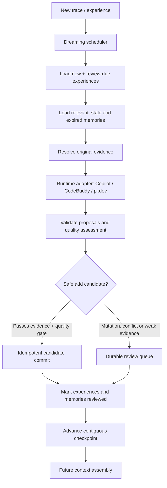

# Agent Memory Dreaming: design and integration

## Decision

Keep the memory data model, knowledge representation and context assembly independent. Add `@saga/agent-dreaming` as a separate, runtime-neutral background orchestration package. It may use Copilot SDK, CodeBuddy SDK, pi.dev or another runtime through a small adapter; it does not import any vendor SDK or database.

The design follows [Anthropic's components of agent memory](https://www.anthropic.com/research/components-of-agent-memory): raw experiences remain inspectable, durable memory is derived from them, knowledge is maintained over time, and only host-selected context is injected into future tasks.

## Responsibilities

- `@saga/agent-tracing`: bounded, redacted execution events and source references.
- `@saga/agent-memory`: durable memory records, lifecycle, relationships, pagination and working-memory selection.
- `@saga/agent-knowledge`: durable knowledge entries and relationships.
- `@saga/agent-dreaming`: background replay, cross-session consolidation, memory review, structured proposals, checkpoints, run ledger and scheduling.
- Host application: storage, evidence resolution, authorization, domain validation, atomic commit, indexing and runtime adapter.
- `@saga/agent-context`: bounded context assembly from host-selected, authorized candidates.

## Execution

A run is bounded by batch size, maximum batches, memory count, relationship count and evidence count. The host ranks memory candidates per batch and resolves redacted, bounded evidence excerpts. The repository selects both unprocessed records and older records due for re-review (30 days by default). It also loads stale or expired memories (`validUntil <= now`) even when they are not directly linked to the current experience batch. The runtime explicitly reports `reviewedMemoryIds`; the engine persists those timestamps separately from experience review. The engine records run state and checkpoints only a contiguous processed prefix. A per-scope distributed lease prevents concurrent workers from applying the same work; the engine renews the lease during long model calls.

## Runtime contract

`DreamingRuntime.generate()` accepts a system instruction, serialized task context and JSON response mode, and returns parsed structured output plus optional model/usage metadata. Provider-specific session lifecycle, authentication, model choice, tool policy, timeout and retries stay in the adapter/host. The package does not assume that all SDKs share the same session or tool APIs.

## Trust boundary

The model only proposes changes. The engine rejects malformed proposals, scope mismatches, unknown targets, unknown evidence references and attempts to promote a new memory to confirmed. New low-risk `add` proposals can be persisted automatically as `candidate` only when they have source provenance and pass the quality gate. Updates, merges, supersedes, archives, missing provenance, missing quality assessments and high-conflict proposals are staged for host review. The model may identify contradicted memory IDs in `conflictsWith`; the engine checks these against loaded memories and forces explicit conflicts into the review queue. Quality scores (confidence, durability, specificity and contradiction risk) are triage hints, not calibrated truth or permission to promote a memory. Expiry triggers re-review; it does not trigger deletion. The host's `commitProposal` must re-check permissions, target versions, evidence and domain rules, then apply changes and the proposal idempotency key in one transaction. It must preserve original evidence and prior memory versions.

A confirmed status is assigned only by host-owned policy after independent validation. `buildWorkingMemory()` excludes candidate and unclassified legacy records by default, so proposed memories cannot silently leak into normal prompt context. Memories are periodically reloaded for review and those past `validUntil` are treated as review-due, not deleted. Conflicting evidence remains explicit; no model-generated update or archive can silently overwrite history.

## Automatic operation

The host creates the engine during service startup and calls `start()`. This runs each configured scope once, then repeats on an interval. Applications should call `notifyRecordAppended(scope)` after committing a meaningful experience. The host calls `shutdown()` during graceful shutdown. The repository must implement `stageProposal` as a durable review queue, as well as idempotent candidate commits. A persistent repository is required for restart recovery; the in-process timer is only a trigger, not the source of truth.

## Non-goals

No built-in database, vector store, graph engine, provider SDK, hosted queue, multi-tenant authorization, autonomous trust promotion or application-specific retention policy. SQLite is a suitable host implementation for a single process; multi-process deployments should use a transactional database and distributed lease.

## Long-term quality feedback

The host records immutable feedback against a memory ID: task usefulness after retrieval, later evidence support/contradiction, explicit user corrections, and human review outcomes. A retrieval event is not automatically positive; the host should emit useful/not-useful only when the task outcome is known.

`evaluateMemoryQuality()` computes separate recency-weighted usefulness and evidence-support rates over a 180-day window with a 90-day half-life. It reports sample size, effective sample size, corrections and human rejections. Review thresholds require repeated observations; a single negative retrieval is not enough. Human rejection is treated as an explicit review request.

The engine loads these summaries with the selected memories and supplies them to the runtime as additional context. They can trigger a new staged review proposal, but cannot directly mutate, delete or demote a memory. Feedback is immutable and host-authenticated; the model cannot author feedback events or claim user confirmation.

