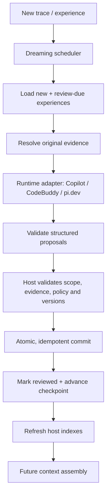

# Agent Memory Dreaming: design and integration

## Decision

Keep the memory data model, knowledge representation and context assembly independent. Add `@saga/agent-dreaming` as a separate, runtime-neutral background orchestration package. It may use Copilot SDK, CodeBuddy SDK, pi.dev or another runtime through a small adapter; it does not import any vendor SDK or database.

The design follows [Anthropic's components of agent memory](https://www.anthropic.com/research/components-of-agent-memory): raw experiences remain inspectable, durable memory is derived from them, knowledge is maintained over time, and only host-selected context is injected into future tasks.

## Responsibilities

- `@saga/agent-tracing`: bounded, redacted execution events and source references.
- `@saga/agent-memory`: durable memory records, lifecycle, relationships, pagination and working-memory selection.
- `@saga/agent-knowledge`: durable knowledge entries and relationships.
- `@saga/agent-dreaming`: background replay, cross-session consolidation, memory review, structured proposals, checkpoints, run ledger and scheduling.
- Host application: storage, evidence resolution, authorization, domain validation, atomic commit, indexing and runtime adapter.
- `@saga/agent-context`: bounded context assembly from host-selected, authorized candidates.

## Execution

A run is bounded by batch size and maximum batches. The repository selects both unprocessed records and older records due for re-review. The engine records run state, checkpoints only a contiguous processed prefix, and records review timestamps to avoid selecting the same old records on every tick. A per-scope distributed lease prevents concurrent workers from applying the same work; the engine renews the lease during long model calls.

## Runtime contract

`DreamingRuntime.generate()` accepts a system instruction, serialized task context and JSON response mode, and returns parsed structured output plus optional model/usage metadata. Provider-specific session lifecycle, authentication, model choice, tool policy, timeout and retries stay in the adapter/host. The package does not assume that all SDKs share the same session or tool APIs.

## Trust boundary

The model only proposes changes. The engine rejects malformed proposals, scope mismatches, unknown targets, unknown evidence references and attempts to promote a new memory to confirmed. The host's `commitProposal` must re-check permissions, target versions, evidence and domain rules, then apply changes and the proposal idempotency key in one transaction. It must preserve original evidence and prior memory versions.

A confirmed status is assigned only by host-owned policy after independent validation. Conflicting evidence should remain explicit until a domain-aware resolver can decide; the model must not silently overwrite history.

## Automatic operation

The host creates the engine during service startup and calls `start()`. This runs each configured scope once, then repeats on an interval. Applications should call `notifyRecordAppended(scope)` after committing a meaningful experience. The host calls `stop()` during graceful shutdown. A persistent repository is required for restart recovery; the in-process timer is only a trigger, not the source of truth.

## Non-goals

No built-in database, vector store, graph engine, provider SDK, hosted queue, multi-tenant authorization, autonomous trust promotion or application-specific retention policy. SQLite is a suitable host implementation for a single process; multi-process deployments should use a transactional database and distributed lease.
